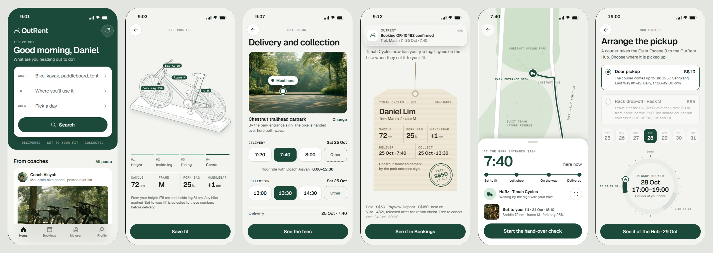

<p align="center">
  
</p>

<p align="center">
  Outdoor gear, delivered and set to your fit.<br>
  Peer-to-peer rental and storage of bulky outdoor gear in Singapore.
</p>

<p align="center">
  <b>Live demo:</b> <a href="LIVE_URL">LIVE_URL</a>
</p>

<p align="center">
  
</p>

## About

OutRent is the high-fidelity prototype (Iteration 2) of a mobile app made for **IS211 Interaction Design and Prototyping** at Singapore Management University, team G14T3.

Bikes, kayaks and camping gear are hard to own in a small flat and hard to rent well. We interviewed 11 people who do outdoor sports in Singapore, and three problems kept coming up:

- **Moving it.** Public transport cannot carry the gear, and most people have no car that fits it.
- **Fit.** Bad rentals were about the wrong size, not the price.
- **Space.** People give up gear they still use because there is nowhere to keep it.

OutRent answers each one in a single app: the gear is delivered and collected, every bike is set to the renter's body before it leaves the shop, and gear that sits unused goes to a storage hub, where it can earn rent.

## The story

The prototype follows one persona, **Daniel Lim**, 29, who rides park connectors every week and is about to try the trails for the first time.

- **Renting (01–13).** His coach posts a kit list. He enters his fit, picks a mountain bike, chooses where and when it is handed over, pays, and tracks the delivery. At the trailhead he records the bike's condition, rides, and gets his deposit back. Then he sets up the same bike for every Saturday.
- **Storing (14–18).** His older bike has not moved since May. He sends it to the OutRent Hub, where it is checked in and can be rented out while it is stored.

Every choice Daniel makes (his fit, times, places, payment, the weekly ride, how the bike goes to the Hub) carries through to every later page.

## Run it

You need Node.js 20.19 or newer.

```bash
npm --prefix app install
npm run app:dev
```

Then open the address it prints. On a computer the app shows inside an iPhone frame; on a phone it fills the screen and can be added to the home screen.

```bash
npm --prefix app run build   # static site in app/dist
npm run check                # the design-system rules
node app/e2e/run.mjs         # the end-to-end journeys (with the dev server running)
```

## How it is built

- **React + Vite + TypeScript**, with React Router; motion with **GSAP**. Every motion has a reduced-motion end state.
- **The design system, "the fitter's line":** the app is drawn like a fitting sheet. Tokens in `design/tokens.css`, shared pieces in `design/components.css`, fonts Geist and Geist Mono.
- **Components page:** every shared piece with its states and motion, live, at **/components** in the running app.
- **Story state:** one small store (`app/src/shell/store.ts`) keeps what has happened, so Home, Bookings and My gear always show it.
- **Mock data:** every value comes from `product/MOCK-DATA.md`; the requirements are in `product/REQUIREMENTS.md`.
- **Checks:** `npm run check` enforces the design rules; `app/e2e` walks seven user journeys with Playwright.

## Folders

```
app/          the React app (src/pages/<page>, src/shell, src/gallery, e2e)
design/       tokens.css, components.css, brand, icons, components.html, recipes.html
product/      requirements, mock data, product owner answers
docs/         screenshots
tools/        the design-system checker and helpers
work/         each designer's folder, with the photos the app uses
```

## Team

| | |
|---|---|
| Haoyue Wu (lead) | [haoyue](https://github.com/haoyue-smu) |
| Amanda Kong | |
| Harwin Halim | |
| Joshua Sau | |
| Nguyen Minh Tuan | |
| Shanise John David | |
| Leong Kai Jun | |
