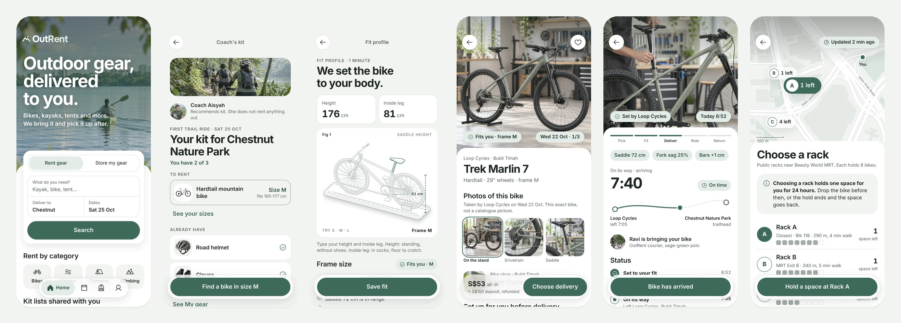

<p align="center">
  
</p>

<p align="center">
  Outdoor gear, delivered to you.<br>
  A peer-to-peer rental app for bulky sports equipment, with delivery, fitting and storage.
</p>

<p align="center">
  
</p>

## About

Bikes, kayaks and camping gear are hard to own in a small flat and hard to rent well. We interviewed 11 people who do outdoor sports in Singapore, and three problems kept coming up:

- **Moving it.** Public transport cannot carry the gear, and most people have no car that fits it.
- **Fit.** Bad rentals were about the wrong size or grade, not the price.
- **Space.** People give up gear they still use because there is nowhere to keep it.

OutRent answers each one inside a single app. The platform delivers and collects the gear. Every bike is set up to the renter's body before it leaves the shop. Gear the owner is not using goes to a storage hub, where it can earn rent, or to a public bike rack nearby.

This repo is the high-fidelity prototype of that app: 18 pages, built as a mobile web app at 393 × 852.

## The journey

The prototype follows one persona, Daniel, a regular rider getting ready for his first trail ride.

**Renting.** A coach shares a kit list. The app checks it against the gear Daniel already owns, finds a bike in his size, delivers it set up to his fit, and collects it after the ride.

**Storing.** Daniel's older bike has not moved in months. He sends it to the hub, or drops it at a public rack near the end of his ride.

| Renting | Storing |
|---|---|
| 01 Home · 02 Coach's Kit · 03 Fit Profile | 14 My Equipment |
| 04 Search Results · 05 Listing Detail | 15 Equipment Detail |
| 06 Delivery & Return · 07 Fees & Liability · 08 Booking Confirmation | 16 Storage Options |
| 09 Trips · 10 Delivery Tracking · 11 Handover Check | 17 Hub Pickup |
| 12 Rental Summary · 13 Weekly Ride | 18 Storage Map |

The full map of the app, with every link between pages, is in [`team/sitemap.html`](team/sitemap.html).

## Design system

Every page is built on **Trail Glass**, a small design system kept in [`design/`](design/):

- **Photography leads.** Controls over a photo use frosted glass; everything you read sits on solid white.
- **One accent.** A single sage green, used for what belongs to the user and what to do next.
- **Calm by default.** Daily screens stay still. A few key moments carry the motion: the kit being checked, the bike being set up, the courier on the way.

Colours, type, spacing and motion are tokens in [`design/tokens.css`](design/tokens.css). Components are in [`design/components.css`](design/components.css), with a live gallery at `/design/components.html` when the preview is running. [`design/DESIGN.md`](design/DESIGN.md) has the full rules.

## Run it locally

You need [Node.js](https://nodejs.org) 20 or newer. There are no dependencies to install.

```bash
git clone https://github.com/haoyue-smu/outrent.git
cd outrent
npm run setup
npm run dev
```

Open http://localhost:5173. The start page lists every page.

On a new computer, the install script sets up Git, Node and VS Code:

```bash
bash tools/install/install-mac.sh                                            # macOS
powershell -ExecutionPolicy Bypass -File tools\install\install-windows.ps1   # Windows
```

## Project structure

```
design/        Trail Glass: tokens, components, icons, brand, recipes
specs/         a brief for each page: purpose, content, states, links
team/          sitemap of the whole app
templates/     starting files for a new page
tools/         preview server, design checker, setup scripts
work/<name>/   pages, one folder per designer
docs/          images for this README
pages.json     page list and owners
AGENTS.md      rules for AI coding agents working in this repo
```

Each page lives in its own folder:

```
work/<name>/<page-id>/
  direction-a/index.html   the page
  direction-b/index.html   optional: a second, clearly different idea
  DECISIONS.md             image requests and notes
```

## Built with

- **HTML, CSS and vanilla JavaScript.** No framework and no build step, so any page opens straight in a browser.
- **[Onest](https://fonts.google.com/specimen/Onest)** for type and **[Phosphor](https://phosphoricons.com)** for icons.
- **[GSAP](https://gsap.com)** for the motion on a few key pages.
- **A design checker** ([`tools/check.mjs`](tools/check.mjs)) that runs before every commit and blocks colours, fonts, sizes or images that are outside the system.

| Command | What it does |
|---|---|
| `npm run setup` | Checks Node and turns on the pre-commit check |
| `npm run dev` | Starts the preview at `localhost:5173` (`PORT=5174 npm run dev` for another port) |
| `npm run check` | Checks every page against the design system |
| `npm run new -- <name> <page-id>` | Creates a page folder from the templates |

## Contributing

Each designer owns a few pages and works on their own branch, `work/<name>`. `main` is protected and is merged by haoyue.

1. Read the page brief in `specs/<page-id>.md`.
2. Build the page in `direction-a`. If you have a genuinely different second idea, build it in `direction-b`, choose one and record why in `DECISIONS.md`.
3. Improve the page.
4. Run `npm run check` until nothing is marked `✗`, then push to your branch.

Use `.img-ph` placeholders for photos and list each one under *Image requests* in `DECISIONS.md`. If you use an AI coding agent, point it at [`AGENTS.md`](AGENTS.md) first.

## Team

Built by team G14T3 for IS211 Interaction Design and Prototyping at Singapore Management University.

| Designer | Pages |
|---|---|
| Haoyue | 01 Home · 02 Coach's Kit · 03 Fit Profile · 05 Listing Detail · 10 Delivery Tracking · 18 Storage Map · design system |
| Amanda | 04 Search Results · 06 Delivery & Return · 07 Fees & Liability |
| Harwin | 08 Booking Confirmation |
| Kai Jun | 09 Trips · 13 Weekly Ride |
| Minh Tuan | 11 Handover Check · 12 Rental Summary |
| Shanise | 14 My Equipment · 15 Equipment Detail · 16 Storage Options |
| Joshua | 17 Hub Pickup |
